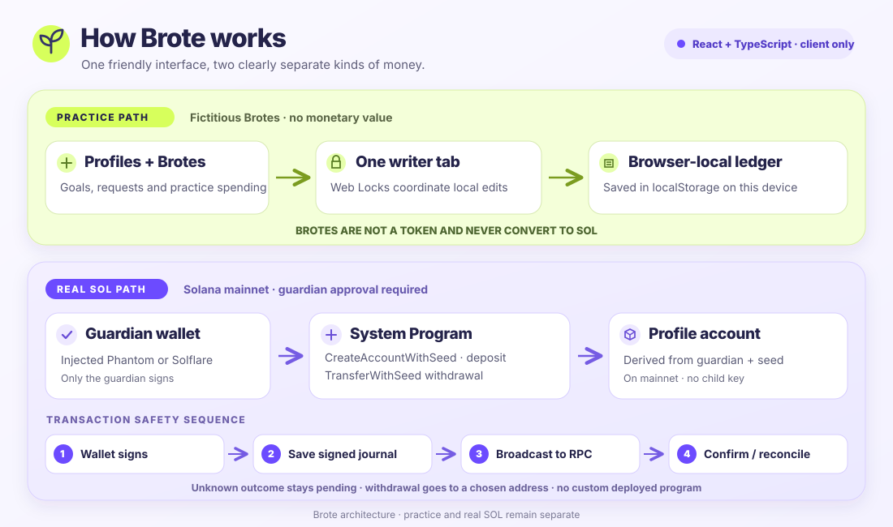
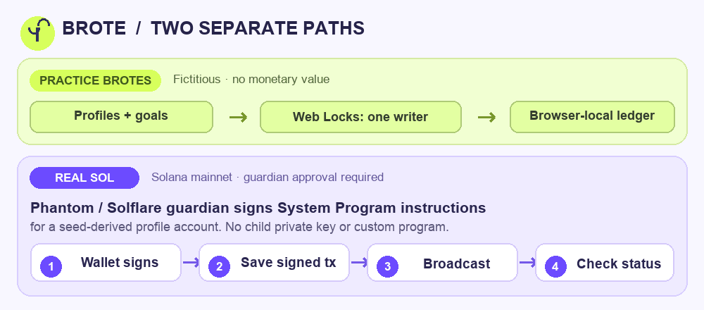

# Brote

**Learn money skills together. Start with practice. Explore Solana with someone you trust.**

Brote is a responsive web app where a guardian creates profiles for children, adults, or seniors, reviews practice spending, and helps them learn through savings goals and short games. The interface supports **Spanish, English, and Brazilian Portuguese**; repository documentation is English.

## Try it

[Live website](https://brote-three.vercel.app) · [Open the app](https://brote-three.vercel.app/app/) · [Architecture diagram](https://brote-three.vercel.app/architecture/)

Practice mode works without a wallet: create a profile, assign fictional **Brotes**, complete a mission, and review a purchase request. Solana mode supports Phantom, Solflare, and read-only public addresses.

## Architecture



- **React + TypeScript + Vite** serve the landing page and app as static files. No backend is required for this prototype.
- **Practice:** an immutable ledger handles balances, goals, approvals, and once-only XP rewards. Browser storage persists the state; Web Locks coordinate one writing tab. CSV exports and JSON backups support review and recovery.
- **Real SOL:** `@solana/web3.js` derives a separate zero-data System Program account for each profile using `PublicKey.createWithSeed(guardian, profileSeed, SystemProgram.programId)`. The guardian's injected wallet signs account creation, deposits, and `TransferWithSeed` withdrawals. Brote stores no child private keys and deploys no custom program.



Signed transaction bytes are saved locally **before broadcast**. Uncertain outcomes block new signatures; recovery checks chain status or explicitly rebroadcasts the same bytes. Both mainnet and testnet are available in the production app. **Mainnet is the default**; choose Testnet in the Solana view or open `/app/?mode=crypto&network=testnet`. The selection reloads the page. Each network has separate browser storage, backups, verified RPC connections, and Explorer links. Practice Brotes have no monetary value and never become SOL.

See [the Solana integration](SOLANA.md), [localization](docs/LOCALIZATION.md), and [interactive architecture diagram](https://brote-three.vercel.app/architecture/) for details.

## Run locally

Use Node.js **22.12+** and npm.

```sh
npm ci
npm run dev
npm test
npm run build
```

Optional: set `VITE_SOLANA_RPC_URL` for mainnet and `VITE_SOLANA_TESTNET_RPC_URL` for testnet. Each must be a browser-accessible HTTPS endpoint for its named network. Vite exposes these values in the client bundle, so use endpoints intended for public clients. Without overrides, Brote uses genesis-verified public endpoints. The former `VITE_SOLANA_NETWORK` build selection is no longer used by the app.

## Prototype scope

Profiles, practice history, and the signed-operation journal are stored in this browser. The family/personal view switch is a demo control; local limits and consent prompts are not on-chain enforcement or account authentication. Real activity shows blockchain transfers, not merchant purchase details. Live testnet creation, deposits, withdrawals, and recovery were verified with a disposable QA wallet. Phantom/Solflare extension UI and funded mainnet execution still require a user-led test. Visa and production custody are future work.

[Roadmap](docs/ROADMAP.md) · [Pitch](docs/PITCH.md) · [Deployment](docs/DEPLOYMENT.md) · [Audit](docs/AUDIT.md) · [Testnet evidence](docs/TESTNET_QA.md) · [Verification](docs/VERIFICATION.md) · [Commit guide](docs/COMMITS.md)

## License

[MIT](LICENSE) © 2026 Kevin Bravo.
