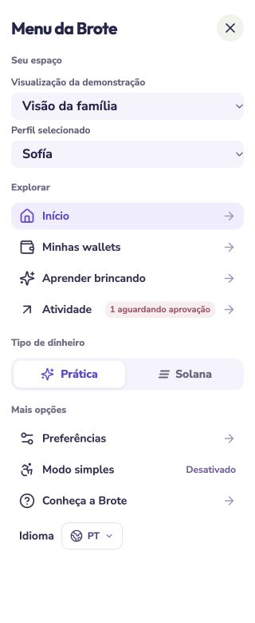
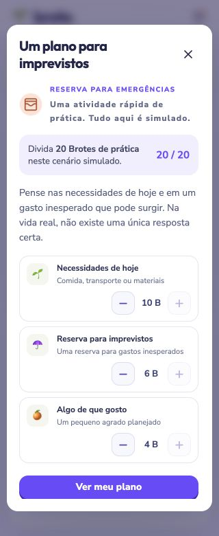

# Interface localization

Brote supports Spanish (`es`, default), English (`en`), and Brazilian Portuguese (`pt`, formatted as `pt-BR`). Select a language in the landing header, desktop app bar, or full-height mobile side menu. Repository documentation remains English.

## How it works

`src/i18n-core.ts` owns the language and source-message catalogs in `src/locales/`. `useI18n()` subscribes React components with `useSyncExternalStore`. The choice is stored separately under `brote-language`; storage events synchronize open tabs. Invalid or unavailable storage falls back to Spanish, while an in-session choice still works. The document language, title, and description update with the selection.

Messages support named placeholders and existing runtime error templates. Reverse lookup lets a visible notification or form error change languages without recreating the operation. Names, addresses, IDs, instruction bytes, and backup schemas remain unchanged. Unknown external RPC details and user-authored text remain available as supplied.

`Intl` formats balances, dates, chart weekdays, and SOL display separators using `es-VE`, `en-US`, or `pt-BR`. SOL formatting preserves integer lamports; input accepts one decimal comma or point. Read-aloud quiz prompts use the selected speech locale. CSV headings and known display descriptions are translated; ISO timestamps, exact numeric values, and machine type/status IDs remain stable for data exchange.

## Coverage and checks

Localized surfaces include the landing page, dashboard, profile creation and consent, wallet rules, funding, purchases, goals, approvals, activity filters, preferences, recovery, Solana account actions and native review prompts, all three learning games, feedback, XP, badges, notifications, placeholders, and accessibility labels.

Independent Luna reviews found frozen notifications, a generic Portuguese document tag, and an untranslated incompatible-account error. These were corrected. Browser review also caught the landing practice note and generated reward/top-up/savings descriptions; regression coverage now includes those cases.

Chrome checks covered **120 layout combinations**: Spanish, English, and Portuguese across landing, dashboard, learning, and Solana at ten viewports:

`320×780`, `375×812`, `390×844`, `430×932`, `768×1024`, `820×1180`, `1024×900`, `1280×800`, `1440×900`, `1920×1080`.

None had horizontal document overflow. Representative screenshots were visually inspected, including the Portuguese 320px side menu and emergency game. English quiz completion awarded XP and practice Brotes once and generated translated activity. Changing language from another tab preserved the name typed into an open profile form. A Solana validation error changed from English to Portuguese without losing its input. English activity, settings, and the 320px simple learner view were inspected. Solana's desktop input and action both measured 44px; mobile controls retain the shared 34px sizing.

The regression suite and production build pass. These checks use desktop browser emulation; they do not replace physical-device, screen-reader, native voice, or user studies across the intended age range.
