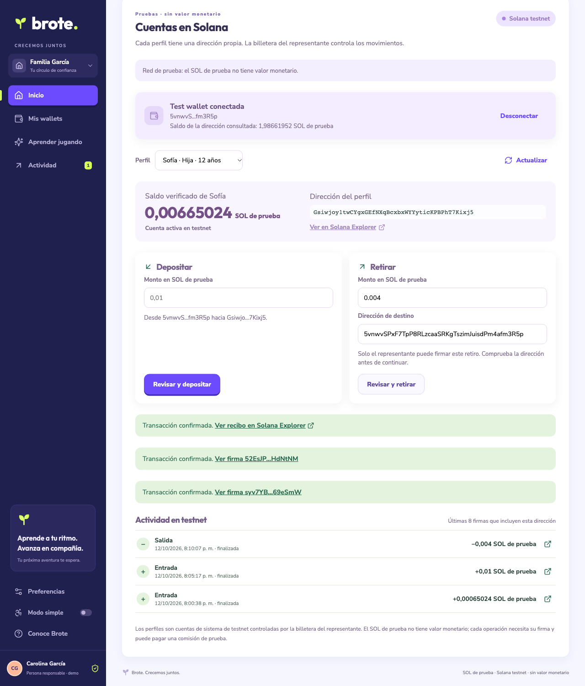

# Live Solana testnet verification

On October 12–13, 2026 (UTC), a disposable wallet received 2 test SOL from [TestnetFaucet](https://www.testnetfaucet.org/), listed in [Solana's faucet guide](https://solana.com/developers/cookbook/development/airdrops-and-faucets). The official RPC airdrop had returned an internal error and then a rate-limit response. No mainnet funds were used.

The runner verified testnet genesis `4uhcVJyU9pJkvQyS88uRDiswHXSCkY3zQawwpjk2NsNY` and exercised Brote's actual signing, fee/rent guard, journal, and reconciliation functions. The final paced run passed. An earlier burst run failed before its injected-send assertion; the harness now preserves underlying errors and spaces requests. Public RPC availability remains variable.

## Confirmed transactions

| Check | Testnet Explorer | Outcome |
|---|---|---|
| create-profile | [2p9hbp6WSz…](https://explorer.solana.com/tx/2p9hbp6WSz2s43oS25KdiuBUVAQqpM8y6W1RGEcC1emWqBqM1L3kdPZ5e24vbYBc7GT6DsBsmQbWiqkVwjhfP9aZ?cluster=testnet) | confirmed |
| deposit | [5bVAZoq3CK…](https://explorer.solana.com/tx/5bVAZoq3CKztwHH2hk9TU4cLa59QhShf8M4UusLjr3qqqj9h5M8zGSrevDLApwWjdVqSyuZbEtdrWNKG9WTZnkGL?cluster=testnet) | confirmed |
| withdraw-to-guardian | [4arZfd9ZR6…](https://explorer.solana.com/tx/4arZfd9ZR6cjq1hwB62krrV1asUJbUDGmSkZdwGQ15krDJU1Kb9QMydp4j7hqMgjCtNiAcwMB1xeo14m4FSjtMqW?cluster=testnet) | confirmed |
| identical-bytes-rebroadcast | [2cBapbQeaW…](https://explorer.solana.com/tx/2cBapbQeaW62VotaZiBsrbwfc8w2CkfE7AuHbgJCUy29n75H2FZKncUNEKENvYYxdNDGvsshcDHRKLbv9rztVXwZ?cluster=testnet) | verified |
| lost-response-recovery | [2cBapbQeaW…](https://explorer.solana.com/tx/2cBapbQeaW62VotaZiBsrbwfc8w2CkfE7AuHbgJCUy29n75H2FZKncUNEKENvYYxdNDGvsshcDHRKLbv9rztVXwZ?cluster=testnet) | verified |
| withdraw-all | [2ajCfatLMc…](https://explorer.solana.com/tx/2ajCfatLMcm4VgAXuhMdiVSMXqg96Mr2AsY8LZzGnaoSBt6Rxw4Z9pWT22w2E7Cj8tyNwGZCqCG7x4fVMCT9qFmV?cluster=testnet) | confirmed |

Repeated broadcast used the original signed bytes and signature. The balance increased once. Imported records stayed pending until RPC confirmation. Complete withdrawal left the profile at zero. A simulation with another guardian base failed with System Program error 5 and left funds unchanged.

Machine-readable results: [testnet-smoke.json](evidence/testnet-smoke.json).

## Browser wallet and isolation

The browser used an explicitly named **Test wallet**, backed by a protected local throwaway key file, to exercise the app's injected-provider interface. This does not validate Phantom or Solflare extension UI. The key stayed on the Node server and was not included in the browser bundle, Git, or deployment.

The adapter requires a dev server, testnet, explicit opt-in, a loopback bind, matching Host/Origin, and a regular 0600 key file. It verifies genesis, blockhash, guardian/seeded addresses, one System Program instruction, and a maximum of 5 test SOL. Foreign/missing origins and unsupported methods were rejected. Regression tests cover actual BigInt transfer instructions and invalid signing requests.

Testnet profiles, writer locks, and signed-operation journals use separate keys. New backups declare their network; cross-network restores are rejected. Untagged older backups remain mainnet-compatible. Production defaults to mainnet. Testnet has no mainnet fallback.

A live simulation found that a tiny withdrawal to an empty recipient fails rent requirements. Brote now checks the recipient's balance and data-size rent minimum before requesting a signature, alongside the source and guardian checks. Invalid destination addresses have a localized explanation.

## Browser results

Creation, a decimal-comma deposit, and a seeded withdrawal confirmed through the actual app UI. The profile ended at 0.00665024 test SOL. Explorer links retained `cluster=testnet`.

- Create profile: [confirmed transaction](https://explorer.solana.com/tx/syv7YBxHDM8GEN1H8QPheaxdJ8KxNwHvinL1JUAE75rmtao5wSqLAtxrJUejJSgYAq862iHwgv4yf3rby69eSmW?cluster=testnet).
- Deposit 0.01 test SOL: [confirmed transaction](https://explorer.solana.com/tx/52EsJP7qnsXF82ebTHiKwsHLYriA1YH7XfCbLKMuVmB2ZZuoK99vLU9LBmDSwK4aNxhQ7mGJw5MWibofoHdNtNM?cluster=testnet).
- Withdraw 0.004 test SOL: [confirmed transaction](https://explorer.solana.com/tx/F6Fbmih7BVPZP7a7QuE1XDknXVVuUeQWvw4hSwMQhaK736EJiAQUnFcvRQmiGRikMBNZ9uViHKuGdUQCFNEWNev?cluster=testnet).

A testnet backup downloaded from localhost contained both confirmed signatures. Restoring it on the distinct 127.0.0.1 origin made both pending; clicking Verify status reconciled them against testnet and removed the write block. A tiny transfer to an empty destination was rejected before a signing prompt. Invalid destination input was rejected. The final regression suite passes **87 tests**, and both cluster builds pass.



## Reproduce

Create and fund a disposable testnet keypair outside the repository, then run:

```sh
npx tsx scripts/testnet-smoke.ts --keypair /private/throwaway.json --output /tmp/testnet-report.json

BROTE_TEST_WALLET_PATH=/private/throwaway.json \
VITE_BROTE_TEST_WALLET=true \
VITE_SOLANA_NETWORK=testnet \
npx vite --host 127.0.0.1 --port 5174
```

A normal production build exposes both networks and has no QA signing endpoint or test wallet. Open `/app/?mode=crypto&network=testnet` for an ordinary wallet or the explicitly enabled local adapter. `VITE_SOLANA_NETWORK=testnet` in the command above is a server-side QA guard, not the production network selector. Use `Red Solana` to switch networks; it reloads the page into the selected network's separate storage and journal.
